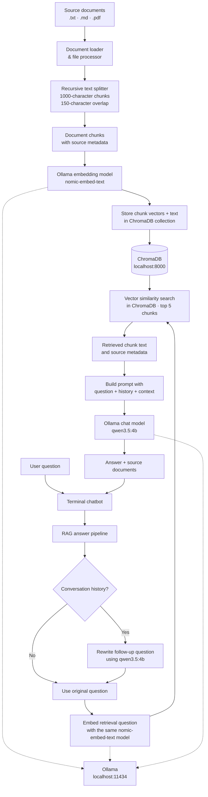

# Local RAG Chatbot

A local document question-answering chatbot built with LangChain, Ollama, ChromaDB, and Node.js.

The application loads `.txt`, `.md`, and `.pdf` files from `docs/`, splits them into chunks, generates embeddings, stores them in ChromaDB, and answers questions with a local Ollama model.

## Architecture



The flow is a standard retrieval-augmented generation (RAG) pipeline. ChromaDB stores
both the chunk text and its embedding, so the query embedding can be compared with
stored vectors and the matching chunk text can be passed to the chat model. The LLM
does not query ChromaDB directly.

In this implementation, `similaritySearch()` performs the query embedding and vector
search internally. The diagram shows those internal steps explicitly for clarity.
The code does not explicitly configure ChromaDB's distance metric, so the diagram
uses "vector similarity search" rather than claiming cosine similarity specifically.

## Requirements

- Node.js 18+
- Ollama
- ChromaDB server running on `http://localhost:8000`

Install the Ollama models:

```bash
ollama pull nomic-embed-text
ollama pull qwen3.5:4b
```

Start Ollama:

```bash
ollama serve
```

Start ChromaDB in a separate terminal. Using the ChromaDB Python CLI:

```powershell
py -m pip install chromadb
chroma run --path .\db --host localhost --port 8000
```

Alternatively, if Docker Desktop is installed, run the command matching your shell:

```powershell
docker run --name chromadb -p 8000:8000 -v "${PWD}\db:/data" chromadb/chroma
```

In Command Prompt (`cmd.exe`), use `%cd%` instead of PowerShell's `${PWD}`:

```bat
docker run --name chromadb -p 8000:8000 -v "%cd%\db:/data" chromadb/chroma
```

Keep the ChromaDB terminal or container running while using the chatbot. You can verify that the server is available with:

```powershell
Invoke-WebRequest http://localhost:8000/api/v2/heartbeat
```

## Installation

```bash
npm install
```

## Add Documents

Place source documents in the `docs/` directory.

Supported formats:

- Markdown: `.md`
- Text: `.txt`
- PDF: `.pdf`

## Create the Vector Store

Run the indexing script after adding or changing documents:

```bash
node src/test/testChroma.js
```

This loads the documents, splits them into chunks, generates embeddings with `nomic-embed-text`, and stores the chunks in ChromaDB.

## Start the Chatbot

```bash
npm start
```

Ask questions in the terminal. Type `exit` to stop the chatbot.

## Run the RAG Test

```bash
npm run test:rag
```

## Project Structure

```text
src/
├── chatbot.js              # Interactive terminal chatbot
├── index.js                # Document loading
├── embeddings/
│   └── embedding.js        # Ollama embedding configuration
├── llm/
│   └── chatModel.js        # Ollama chat model configuration
├── rag/
│   ├── answer.js           # Question-answering pipeline
│   └── retriever.js        # Similarity search
├── utils/
│   └── textSplitter.js     # Document chunking
├── vectorstore/
│   └── chromaStore.js      # ChromaDB integration
└── test/                   # Manual test scripts

docs/                       # Source documents
db/                         # Local ChromaDB data
```

## Configuration

The application currently uses:

- Chat model: `qwen3.5:4b`
- Embedding model: `nomic-embed-text`
- Ollama URL: `http://localhost:11434`
- ChromaDB URL: `http://localhost:8000`
- Retrieved chunks per question: `5`

Configuration files:

- `src/llm/chatModel.js`
- `src/embeddings/embedding.js`
- `src/vectorstore/chromaStore.js`

## How It Works

1. Documents are loaded from `docs/`.
2. Documents are split into overlapping chunks.
3. Ollama generates embeddings for each chunk.
4. ChromaDB stores the embeddings.
5. A user question is converted into a search query.
6. Relevant document chunks are retrieved.
7. Ollama generates an answer using the retrieved context.
8. Source documents are displayed with the answer.
